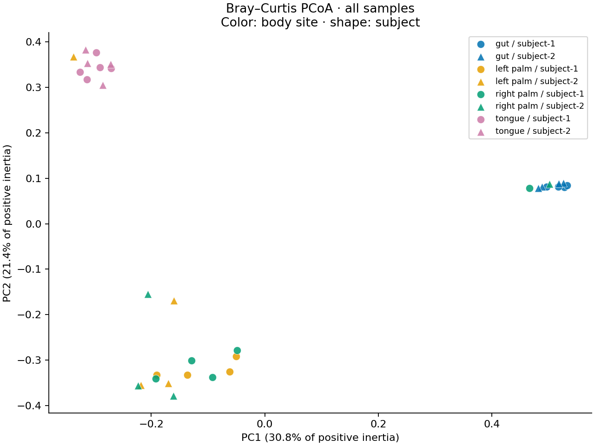
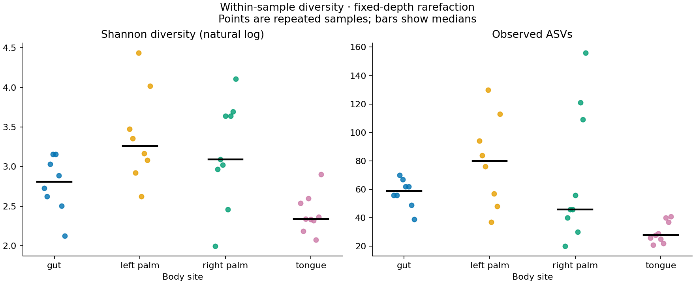
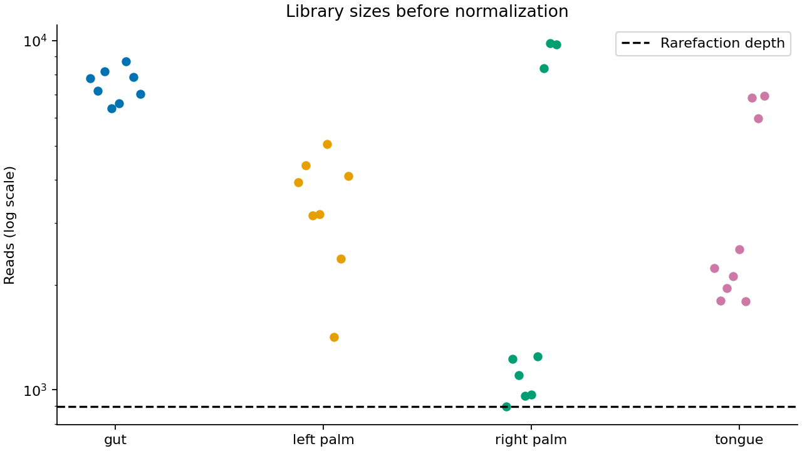

# 16S microbiome — community differences

## Question

Do microbial communities differ among body sites in a public 16S rRNA dataset?

This reproducible analysis uses the public **QIIME 2 Moving Pictures** teaching dataset: 34 samples, 770 ASVs, 4 body sites, and 2 people. Body sites separate visually, but the test that preserves each person's repeated measurements does **not** reach the prespecified 0.05 significance threshold. This result does not establish an absence of site differences.

## Data

Sources: [QIIME 2 2024.10 Moving Pictures tutorial](https://docs.qiime2.org/2024.10/tutorials/moving-pictures/) and the original [Caporaso et al. (2011) study](https://doi.org/10.1186/gb-2011-12-5-r50). The tutorial uses a subset of human V4 16S amplicon reads; it is not an independent validation cohort.

This repository reuses the tutorial's **precomputed DADA2 ASV frequency table**, not raw reads. The original `.qza` artifact retains upstream processing provenance. Exact download URLs and SHA-256 hashes are in [data/sources.json](data/sources.json); the two pinned inputs are committed in [data/raw](data/raw) for offline reproduction. The artifact provenance identifies `denoise_single` with trimming and truncation parameters; these are upstream settings, not a denoising run performed here.

## Approach

1. Verify 2/2 input hashes and exact sample ID alignment; reject duplicate IDs and invalid counts.
2. Rarefy without replacement to **897 reads/sample** (the minimum observed library), seed **26**. No samples are dropped for depth. Raw libraries contain 153,807 total reads and range from 897 to 9,820 reads. Also export unrarefied alpha values for comparison.
3. Compute Shannon entropy using natural logarithms, observed ASVs, relative-abundance Bray–Curtis distances, and classical PCoA for all samples.
4. Restrict inference to **28 samples in 7 complete subject/visit blocks**. The other 6 samples remain in descriptive outputs. Permute site labels consistently across each person's entire trajectory, independently between people: **576 exhaustive labelings per test, including the identity**. This preserves repeated measurements; unrestricted sample shuffling is not used.
5. Test composition with PERMANOVA, alpha outcomes with an exact omnibus site test on subject-centered site means, and dispersion with an approximate positive-PCoA centroid diagnostic. Apply Benjamini–Hochberg correction to the **two alpha tests**. See [methods](docs/METHODS.md) and the prospectively written [scope and acceptance criteria](docs/SCOPE.md).

## Results

| Analysis | Statistic | Exact p | BH q (alpha family) |
|---|---:|---:|---:|
| Bray–Curtis PERMANOVA | pseudo-F = 6.7702; R² = 0.4584 | 0.0833 | — |
| Shannon site test | subject-centered omnibus | 0.0833 | 0.1667 |
| Observed-ASV site test | subject-centered omnibus | 0.4167 | 0.4167 |
| Approximate dispersion diagnostic | positive-axis centroid F | 0.2083 | — |

PERMANOVA attributes **45.84%** of distance variation to body-site grouping in the complete-visit subset. The exact restricted test is not significant at 0.05; the small independent subject count limits inference. Alpha tests also do not pass the threshold after correction. The dispersion diagnostic does not reject, which is not proof of equal dispersion.

Descriptive means below use all samples, so they differ in weighting and coverage from the subject-level inference:

| Body site | Samples | Mean Shannon | Mean observed ASVs |
|---|---:|---:|---:|
| gut | 8 | 2.777 | 57.62 |
| left palm | 8 | 3.385 | 79.88 |
| right palm | 9 | 3.179 | 69.33 |
| tongue | 9 | 2.405 | 29.89 |



PC1 and PC2 account for 30.83% and 21.44% of positive inertia. There are 3 negative eigenvalues with 0.153% of total absolute inertia; the plotted positive-axis projection is approximate.





## Reproduce

Create the environment using the requested Miniconda installation:

```bash
~/miniconda3/bin/conda env create -f environment.yml
source ~/miniconda3/etc/profile.d/conda.sh
conda activate p26-microdiv
python -m pip install -r requirements-lock.txt
python -m pip install -e '.[test]' --no-deps
python scripts/download_data.py --verify-only
microdiv --output results
pytest -q --junitxml=/tmp/p26-pytest.xml
python scripts/write_readme.py --junit /tmp/p26-pytest.xml
```

To fetch missing inputs from the public servers, run `python scripts/download_data.py` (or pass `--destination /tmp/p26-data` to verify a clean download). Existing files must match their pinned hashes. Analysis and pytest use committed inputs and need no network. `requirements-lock.txt` pins the resolved Python packages; `environment.yml` declares the Miniconda environment. GitHub Actions installs the lock file, verifies inputs, runs tests, and regenerates result artifacts.

## Outputs and validation

- [results/summary.json](results/summary.json): computed design, depth, statistics, ordination diagnostics, and package versions.
- [results/statistical_tests.tsv](results/statistical_tests.tsv): all statistics, exact p-values, alpha q-values, and permutation counts.
- [results/alpha_diversity.tsv](results/alpha_diversity.tsv), [unrarefied alpha](results/alpha_unrarefied.tsv), [depth sensitivity](results/alpha_depth_sensitivity.tsv), and [subject/site means](results/alpha_subject_site_means.tsv).
- [Bray–Curtis matrix](results/bray_curtis.tsv), [PCoA coordinates](results/pcoa_coordinates.tsv), [eigenvalues](results/pcoa_eigenvalues.tsv), [normalized counts](results/rarefied_counts.tsv), [sample inclusion audit](results/sample_audit.tsv), and [exhaustive reference statistics](results/permutation_null.tsv).
- [results/acceptance.json](results/acceptance.json): **10/10 automated analysis checks passed**; **13 machine-readable analysis files** (excluding manifest and acceptance report), **3 PNG figures**. [Manifest](results/manifest.json) records every delivered analysis file's size and SHA-256 hash.
- Local pytest: **29/29 passed**. Tests cover numerical reference cases, invalid inputs, restricted permutations, corrupt-input handling without partial writes, manifest integrity, and full offline regeneration against committed results. [CI workflow](.github/workflows/ci.yml) uploads regenerated outputs and a JUnit test report.

## Limitations

- Only 2 independent participants; repeated visits do not increase independent biological replication. Whole-trajectory exchangeability is an assumption, not a randomized design. Exact p-values have a coarse reference distribution. No population-level or causal conclusion is supported.
- Complete-visit inference excludes 6 samples and uses different available visit schedules between people. Antibiotic history and time are not estimated as separate effects. Missingness may be informative.
- Rarefaction discards reads and can change richness. Alternative rarefaction seeds, repeated-rarefaction uncertainty, and a formal depth-sensitivity hypothesis test: **not done**. The unrarefied comparison is descriptive only.
- Raw-read quality control, demultiplexing, and a new DADA2 run: **not done**; the public precomputed table is reused.
- UniFrac and phylogenetic diversity: **not done**; no rooted tree is downloaded or validated. Bray–Curtis is the implemented beta-diversity metric.
- Full signed-axis PERMDISP: **not done**; the reported centroid diagnostic omits negative PCoA axes.
- Taxonomic annotation, pairwise post-hoc tests, differential abundance, independent-cohort validation, and clinical interpretation: **not done**.
